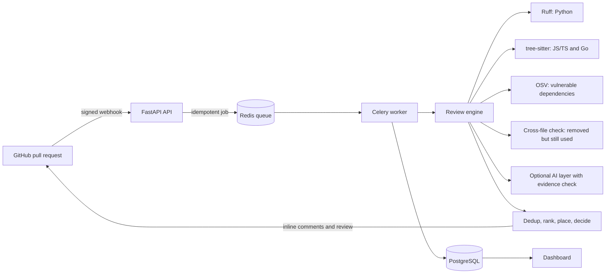

<p align="center"></p>

<h1 align="center">Lyvern</h1>

<p align="center">
  <b>A pull request reviewer that only approves when nothing is left to fix, and measures its own accuracy in the open.</b>
</p>

<p align="center">
  <a href="https://lyvern.vercel.app"><b>Live dashboard (read-only snapshot)</b></a> ·
  <a href="docs/PROJECT_HANDBOOK.md">Handbook</a> ·
  <a href="docs/BENCHMARK.md">Benchmarks</a> ·
  <a href="docs/ML_MODEL_CARD.md">Model card</a>
</p>

---

## In one minute

Lyvern is a **GitHub App**. When a pull request is opened or updated, it reads the change, comments on the exact lines that have problems, asks for changes when something is wrong, tells the author when there is a merge conflict, and **approves only when the code is clean**. It runs for free: open-source analysers, free-tier AI, a local database.

It is built around one idea: **a reviewer you cannot measure is a reviewer you cannot trust.** Every finding can be marked "real problem" or "false alarm" by a person, and the dashboard turns those marks into a measured precision figure with a confidence interval. Nothing is estimated and nothing is invented.

## What the bot does

| When this happens | Lyvern does this |
|---|---|
| A pull request is opened or updated | Reads the diff and runs the analysers on the changed code |
| It finds a problem | Posts an **inline comment on that exact line**, with the rule and the reason |
| Any problem is found | Submits **Request changes** and lists every point in one review |
| The branch cannot merge cleanly | Posts a **separate** comment asking the author to rebase and resolve conflicts (once per commit, never mixed into the code review) |
| The author fixes everything and pushes | Reviews again from scratch and **dismisses its own stale review** |
| The code is clean | **Approves**, but only if there are zero findings of any severity, no conflicts, every file was analysed, the risk score is low, and the repository is on the approval allow-list |
| The base branch moves | Re-checks open pull requests for new conflicts |

**It never merges, never pushes code, and only writes to repositories you list in `LYVERN_WRITE_ALLOWED_REPOS`.**

## How it works



1. **Webhook in.** GitHub sends a signed event. The signature is verified and each delivery is processed once, even if GitHub retries.
2. **Job queued.** The API acknowledges quickly and hands the work to a Celery worker through Redis.
3. **Analysis.** The engine fetches the diff and runs the analysers only on the lines that changed, so old code is never blamed on the author.
4. **Decision.** Findings are de-duplicated, ranked, placed on valid diff lines, and passed to a strict decision engine. An explainable risk score (every point is listed with its reason) accompanies the result.
5. **Review out.** One GitHub review with inline comments. Findings and run details are saved to PostgreSQL.
6. **Feedback loop.** People label findings on the dashboard; the labels become measured precision per rule.

## What it checks

| Layer | Coverage |
|---|---|
| Python | Ruff, including the security (`S`) rules |
| JavaScript / TypeScript | 14 tree-sitter rules (`eval`, shell commands from dynamic input, disabled TLS verification, hard-coded secrets, suppressed TypeScript checks and more). Two noisy rules, empty `catch` and `dangerouslySetInnerHTML`, are **off by default** because testing on real code showed they were mostly false alarms |
| Go | 8 tree-sitter rules; honours `#nosec` and `nolint:gosec` |
| Dependencies | Known vulnerabilities in pinned packages via OSV (opt-in) |
| Cross-file | A symbol that the change removes but other files still use |
| Generated code | Minified, bundled and generated files are detected and skipped for style rules |
| AI layer (optional) | An LLM reads the change; every observation must quote real added code or it is discarded |
| Attention model | A small logistic regression that estimates which pull requests deserve a closer look. Advisory only |

## The dashboard

**Live: https://lyvern.vercel.app** (read-only snapshot of real data, names hidden)

The dashboard is the **control room for the people who run the bot**, not for the developers whose pull requests get reviewed. Those developers only ever see Lyvern's comments on GitHub.

What you can see:

- **Overview:** reviews run, findings reported, inline comments posted, and how many reviews ended in approve, comment, or request changes.
- **Every review:** the result posted, the commit, the findings, and whether an earlier changes-requested review was dismissed after a fix.
- **Every finding:** file, line, severity, category, which rule found it, and the verdict a person gave it.
- **Measured accuracy:** precision with a 95% Wilson confidence interval, overall and per rule, from human labels.

What it is for:

- **Proof.** Every number is read from the database. This is the evidence that the bot does what it claims.
- **Quality control.** Reviewers mark findings right or wrong, which shows which rules to keep, tune or switch off.
- **Showing the project.** The public site lets anyone look at real results without installing anything.

Two modes, one codebase:

| Mode | Who | What |
|---|---|---|
| Private (default) | The owner, admins and reviewers | Sign-in with roles (viewer, reviewer, admin). Reviewers can label findings. Reads the live API |
| Snapshot (`LYVERN_SNAPSHOT=1`) | Anyone | The public Vercel site. Serves a frozen export of the real database, with repositories, files, commit ids and links hidden. No login, no writes |

The deployed site is a snapshot, refreshed on demand with `scripts/export_dashboard_snapshot.py`.

## See it work on real pull requests

The bot's reviews live in a sandbox repository: [`bhuvan-somisetty/lyvern-sandbox`](https://github.com/bhuvan-somisetty/lyvern-sandbox). It is **private** (some pull requests there review code from my other projects), so the link only opens for me. I walk through it live on request. The demo pull requests show every behaviour above:

| Sandbox PR | What it shows |
|---|---|
| #1 Add sample module for review testing | Inline comments on the exact lines, plus a Request changes review |
| #2 Dismissal flow test | The bot dismisses its own stale review after the author fixes the code |
| #3 Add a small clean helper | A clean change: no findings, so the bot approves |
| #4 Conflict demo | Same line changed on main and the branch: a separate "please rebase" comment |
| #5 Flow demo | Conflict, then resolution, then the fix, reviewed again from scratch |
| #6 Deps demo | A vulnerable pinned dependency is flagged; the clean pin is not |
| #7 Xref demo | A helper is removed while other files still use it |

## Measured results, and their limits

These come from `docs/BENCHMARK.md` and `docs/ML_MODEL_CARD.md`. The limits are part of the result.

| Measurement | Result | Read it as |
|---|---|---|
| Synthetic suite, 61 cases | precision 31/31, recall 31/31 | A regression guard. The same author wrote the rules and the cases, so it says nothing about real code |
| First labelled run on real code | 20% precision on 67 labelled findings | An honest low number, produced **before** the noisy rules were switched off. The labels were drafted by the assistant and need a human spot-check. Not a fair figure after tuning on the same sample |
| Six unseen open-source repositories | 17% precision (9 of 54 findings correct) before fixes; 9 findings after | The false alarms were traced to causes (mostly re-export modules) and fixed. The after figure is in-sample, so it is not an accuracy claim. Labels are one person's judgement |
| Real pull requests, static only (30 PRs) | 0 findings on the PRs' own changes | Quiet and safe on well-reviewed code. It does not cover what human reviewers discuss (conventions, intent, tests) |
| Attention model (1,200 public PRs) | held-out AUC 0.70 | About the same as using change size alone. Advisory only, and the model card says so |

A fresh labelled batch of findings on real code is still needed before quoting a precision number.

## Quality gates

- 459 Python tests and 30 web tests, plus strict linting (Ruff, mypy, ESLint, TypeScript).
- GitHub Actions CI on every push.
- Signed commits; webhook signatures verified; secrets never committed; `.env` and the GitHub App private key stay outside the repository.
- No data is invented: the dashboard reads the database or the anonymised export of it.

## Run it for free, with no server

**Actions mode:** copy one workflow file (`.github/workflows/lyvern-review.yml`) into a repository and add the App secrets. The review then runs on a free GitHub-hosted runner for every pull request, with nothing to host or keep running. Setup and limits: [`docs/ACTIONS_MODE.md`](docs/ACTIONS_MODE.md).

**Local mode:** run the whole stack on your own machine (below). This also feeds the dashboard database.

## Run it yourself

Requirements: Docker, Python 3.12, `uv`, Node 24, `pnpm`.

```bash
cp .env.example .env               # fill in your own keys; never commit this file
docker compose up -d --build       # PostgreSQL (host 5433), Redis (6380), migrations, API (8000), worker, web
curl http://localhost:8000/readyz  # {"status":"ready", ...}
```

Draft a review of any pull request from the command line (it never posts):

```bash
uv run lyvern review owner/repo#123
uv run lyvern benchmark synthetic
```

Develop:

```bash
uv sync --all-packages
uv run ruff check . && uv run ruff format --check . && uv run mypy
uv run alembic upgrade head
uv run pytest tests
cd apps/web && pnpm install && pnpm dev
```

Setting up the GitHub App, the webhook and the dashboard login is covered step by step in `docs/SETUP_GUIDE.md`.

## Repository map

| Path | What is there |
|---|---|
| `packages/lyvern/src/lyvern/engine/` | The review logic: contracts, diff parser, analysers, dedup, placement, decision, policy, rendering |
| `packages/lyvern/src/lyvern/ml/` | Features, dataset, training and the runtime attention model |
| `apps/api` | FastAPI service: webhooks, health, read-only dashboard API |
| `apps/worker` | Celery worker that runs review jobs |
| `apps/web` | Next.js dashboard (React 19, Tailwind 4) |
| `data/ml/` | The public pull request dataset used to train the attention model (no usernames) |
| `scripts/` | Snapshot export and brand tooling |
| `tests/` | Unit and integration tests |
| `docs/` | Everything written down |

## Documentation

Start with `docs/PROJECT_HANDBOOK.md` (everything, A to Z). Then `docs/PRD.md` (what and why), `docs/TRD.md` (how), `docs/ARCHITECTURE.md`, `docs/SECURITY.md`, `docs/BENCHMARK.md`, `docs/ML_MODEL_CARD.md`, `docs/SETUP_GUIDE.md`, `docs/ROADMAP.md` and the running `docs/SESSION_LOG.md`.

## Honest scope

Built: everything above. Not built: a full call graph and type-aware analysis, ESLint integration, single sign-on, and a hosted multi-tenant version of the bot. The name is a working name; trademark and domain checks are still open.

## License

MIT, see [`LICENSE`](LICENSE).

---

<p align="center">Built by <a href="https://github.com/bhuvan-somisetty">Bhuvan Somisetty</a></p>
